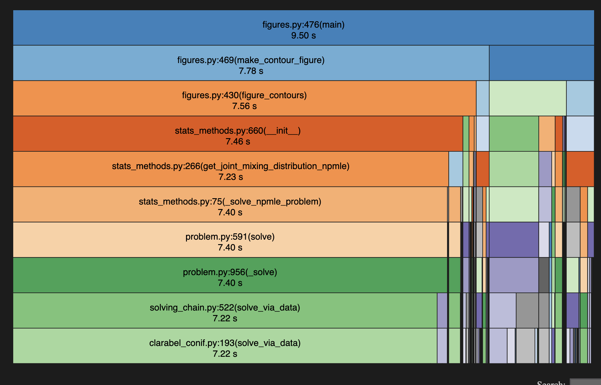
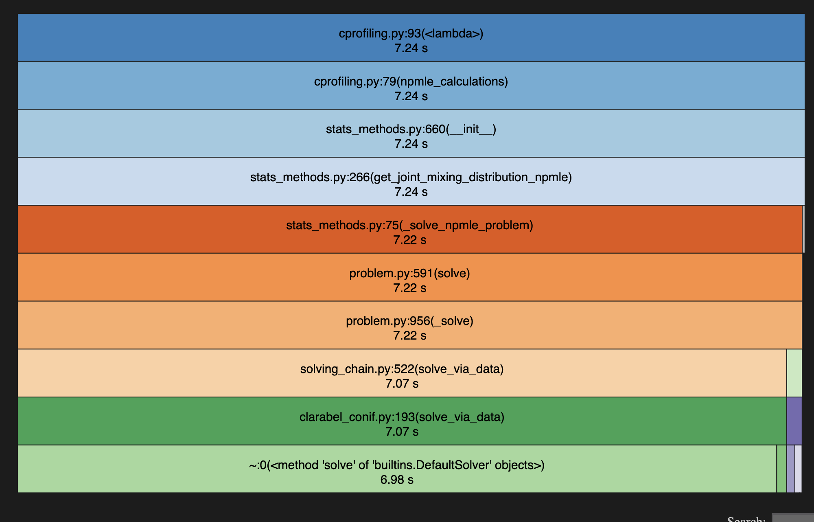

### Baseline

First, some images I'll reference throughout the baseline analysis.

Broad picture (fill figure creation pipeline profile):

Just the estimation step:

The first baseline profile is of the whole end-to-end figure creation script, with profile at [before__src*.prof](profiles/before__src.figures.mainf5bb7e7.prof). Even including all the figure creation steps which I was worried would muddy the picture, the main culprit is far and away the NPMLE calculation with the cvxpy CLARABEL solver.

The first profile above includes the figure generation process and cvxpy NPMLE estimation procedure, and clearly the cvxpy solve takes the majority of time. When I reduce the problem to just the NPMLE estimation procedure in the second profile, the actual time running the CLARABEL solver is far and away the dominant time sink. Note: this second profile is for the correlated mean/variance case (see [before_dependent_calculations*.prof](profiles/before_dependent_calculationa49d7cb.prof)). The independent case is similar, but takes far less time (100x faster).

One interesting thing I found in this was that for the quicker independent mean/variance case, the cvxpy solver took about of a 4th of its time *reducing* the problem to something a conic solver could handle. So it wasn't just solving the problem but reducing it that took time. Then not merely is the actual solving of the convex optimization problem important but if we cared mostly about the independent case then we would also want to maybe speed up the time it takes the solver to run its conic solver reduction.

I made the judgment call that we don't care about the independent case so much because it is so much faster. Of course, Amdahl's law doesn't quite apply here because maybe in applications we really care about the independent case and don't care so much about the correlated mean/variance structure case. I think that actually, independence is not as defensible in applications, so I stand by prioritizing the much slower solver for the dependent/correlated case.