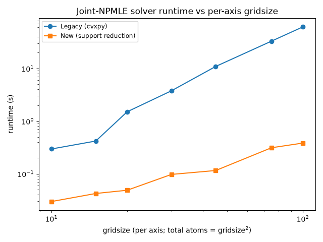
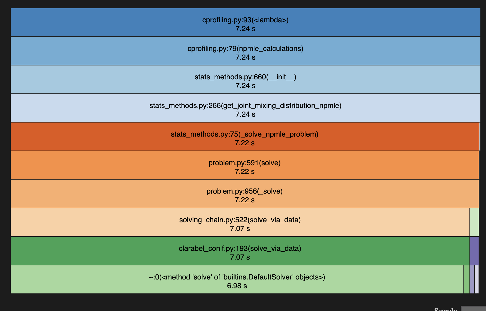
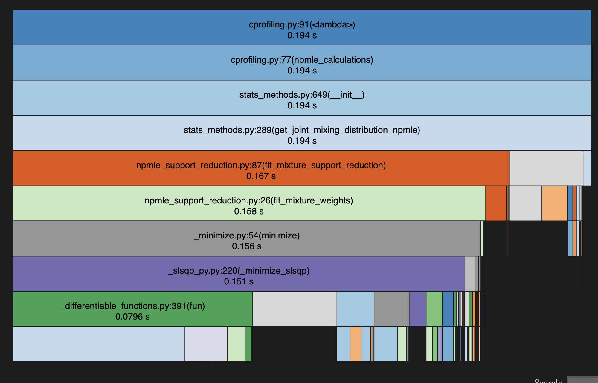

# Profiling and optimization for the Unit 2 project

The TL;DR on the process I went through is:
1. baseline profiling
2. timing different cvxpy solvers
3. timing non-cvxpy methods
4. used logscale and row-rescaling of the likelihood matrix for numerical stability

The result was that the code sped up 38x from ~7.24 sec to ~0.19 sec on the default settings, with increasing gains for larger problems (e.g. a ~250x speedup on support gridsizes of 100x100), as seen in this log-log plot of the old vs new implementations:


 

### Profiling the different solver options

Per the [cvxpy webpage](https://www.cvxpy.org/tutorial/solvers/index.html), I found my installed solvers with:
```
>>> cp.installed_solvers()
['CLARABEL', 'SCS', 'SCIPY', 'HIGHS', 'OSQP']
```

Unfortunately, when I tried seeing which of these improves the time to solve the problem (in speed_comparison_convex_solvers.py), I found that CLARABEL (the original solver I had used) was the only viable option:

------------------------------------------------------------------------
|solver         | best time (s) |     accuracy dist | status|
| ---------|--------------|--------------|----------------------------------
CLARABEL        |      7.1590 |        0.000e+00 | ok
SCS          |             --          |      -- | TIMEOUT (exceeded 15s)
SCIPY         |            --           |     -- | FAILED: SolverError: The solver SCIPY cannot solve this problem.
HIGHS       |              --            |    -- | FAILED: SolverError: The solver HIGHS cannot solve this problem.
OSQP        |              --           |     -- | FAILED: SolverError: The solver OSQP cannot solve this problem.
------------------------------------------------------------------------

Sadly, this particular stage was a largely unsuccessful attempt to find a speedup.

### Alternatives to cvxpy

(see discussion of what each alternative means more specifically below)

So, I tried a new approach. One option is to use a naive Scipy solver (I thought, who knows, maybe it would work even though the problem is suited to a convex solver), and another is to use active support reduction as detailed later. Because I want a quick comparison, I had GPT write first drafts of these implementations and I tested in speed_comparison_convex_solvers.py (on a reduced gridsize of 20x20 because 40x40 was too large for the first algorithm):

|method|time|error|within tolerance?|
|-----|------|------|------|
| support-reduction            |       0.0328      |   2.482e-06 | ok |
| default (CLARABEL->SCS)      |       1.4711       |  0.000e+00 | ok |
| scipy-SLSQP            |             5.2674    |     9.751e-06 | ok |

From this, support reduction seems like a promising method. But upping the gridsize back to 40x40, the solution suddenly seemed very inaccurate:

|method      |                 best time (s)  |   accuracy dist  |status|
|--------|----------|-------|-----------------------------------------------------|
|default (CLARABEL->SCS)       |      7.2274     |    1.500e-16 | ok|
|support-reduction            |       0.0337     |    8.314e+00  |INACCURATE|

Upon further inspection, this was because the solver fails after its second iteration, because adding a new point, the weight of the new point is nearly 0. I upped this new weight initialization to a small constant epsilon=1e-3 and found it maintained the speedup but brought the accuracy (measured by a Wasserstein metric) to within 1e-4 instead of the 8 we saw above.

The results of this section are reproducible with `make solver_benchmark`

### ~ Alternative 1: Scipy SLSQP
I replaced the step of optimizing with cvxpy's CLARABEL solver with the scipy SLSQP solver instead. This scales remarkably poorly. :(

### ~ Alternative 2: support reduction
Solving the convex optimization problem over a 40x40 grid was slow, but in the end only a few points among those 1600 actually have any mass on them.

So, this method adds points one by one and optimizes at each stage, so it deals with at most the 20 or so points that are actually necessary to fully describe the support of the NPMLE distribution.

I went with this alternative because of its massive speedup, and I checked with the regression test in [tests/test_regression_optimized_consistency.py](tests/test_regression_optimized_consistency.py) that it produces the same result (to within an optimal transport cost of 1e-3; we can't directly compare errors on each support point because close solutions might be supported on a slightly different set).

I will say one cost of this implementation is that it may be less readable because the first implementation uses the self-explanatory cvxpy syntax but this reveals the guts of the optimization a bit more. My solver is also less tested than the cvxpy implementation likely is, and a mature library may be more reliable in edge cases. But a ~250x speedup on gridsizes of 100x100 is hard to pass up.

### One more optimization: numerical stability with arithmetic in log space and row-normalization of the likelihood matrix

As we saw in class, doing arithmetic in log space can be more stable numerically when we have for instance a bunch of tiny numbers that are getting added/multiplied.

Also! We can normalize the rows of the likelihood matrix A, changing the total likelihood by a constant independent of $f$:

$$
\begin{aligned}
\mathrm{argmin}_{f>0, \sum f_i = 1} [\vec{1}.T @ log(A @ f)] & = argmin_{f>0, \sum f_i = 1} [\vec{1}.T @ log(A_{ij} f_j)-1.T @ log(\max_j(A_ij))\vec{1}]\\
& = argmin_{f>0, \sum f_i = 1} [\vec{1}.T @ log((A_{ij}/\max_j(A_{ij})) f_j)]
\end{aligned}
$$

In this case, it seems like the bigger change was improving the algorithm by limiting the number of points its optimizing over at once; the numerical stability didn't even change the results as evidenced by the regression test. So at least on this test problem, the numerical stability doesn't pose a major problem. But perhaps this more principled approach would be better in future edge cases that I have not anticipated.

### Code comparison

Original:
```
f_joint = cp.Variable(n_atoms)
max_likelihood = cp.Maximize(cp.sum(cp.log(A_joint @ f_joint)))
constraints = [f_joint >= 0, cp.sum(f_joint) == 1]
problem = cp.Problem(max_likelihood, constraints)
cvxpy_solve_wrapper(problem)
```

Scipy SLSQP:
```
from scipy.optimize import minimize
def objective(w):
    q = np.max(A @ w, 1e-200)
    if np.any(q <= 0):
        return np.inf, np.zeros(p)
    value = -np.mean(np.log(q))
    gradient = -(A.T @ (1.0 / q)) / n
    return value, gradient

return minimize(
    objective,
    x0,
    jac=True,
    method="SLSQP",
    bounds=[(0.0, 1.0)] * p,
    constraints={
        "type": "eq",
        "fun": lambda w: w.sum() - 1.0,
        "jac": lambda w: np.ones(p),
    },
    options={"ftol": ftol, "maxiter": maxiter},
)
```

Support reduction method:
```
q = A[:, support] @ w
g = (A.T @ (1.0 / q)) / n
j = int(np.argmax(g))
gap = max(0.0, float(g[j] - 1.0))

if gap <= gap_tol:
    status = "converged"
    break
support = np.append(support, j)
w = np.append(w, 0.0)
```


### Final comparisons and replicating my results

Try `make solver_benchmark` for the test I ran to identify a speedup by changing the solver.

Try `make timing_comparison` to reproduce the image [results/figures/timing_comparison*.png](results/figures/timing_comparison_620f8b3d4948bb2e_seed0.png).

Try `make test` which includes the regression test in [tests/test_regression_optimized_consistency.py](tests/test_regression_optimized_consistency.py).

Try `make create_profile` to profile the current implementation.

Try `make profiles` to visualize (using snakeviz) the current implementation's profile and the baseline profile in two tabs in your browser.